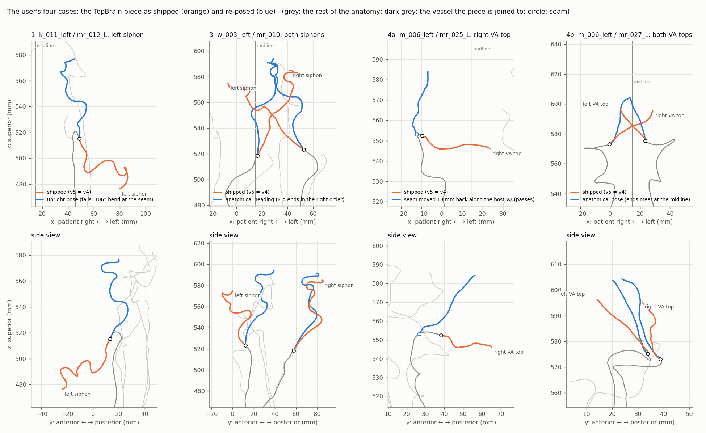
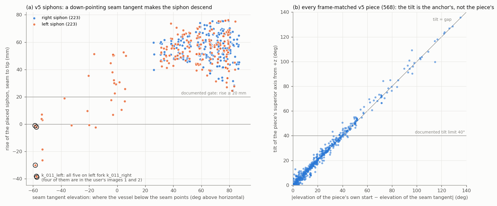
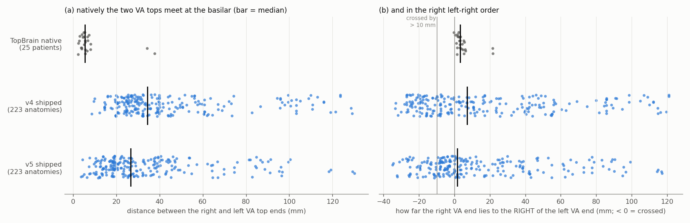

# TopBrain piece orientation audit (v5)

Date: 2026-10-03. Scope: every TopBrain piece in the 223 anatomies of `carotid_data/anatomies_v5`, with v4 and v3
measured the same way for comparison. The pieces are the right and left ICA siphons, the TopBrain ECA tips and the
TopBrain VA tops. The audit also covers every code path that places such a piece, and the three v5 VAs narrower than
0.65 mm.

It was triggered by your note on four v5 images. They show left ICA siphons in case_k_011_left and case_w_003_left,
and the TopBrain VA tops in case_m_006_left, going sideways or down instead of rising. You remembered that the same
mistake had been fixed in the v1–v3 era by aligning superior as well as the tangent, and assumed that the checks had
carried into every later generation.

Four agents did the work, and a fifth checked it independently:
- tbo_history: the documented fix and the code paths;
- tbo_geom: a per-piece measurement of all three versions;
- tbo_cause: the root cause, re-run in scratch, plus candidate fixes;
- va_narrow: the three narrow VAs;
- verify_tbo: an independent check with its own code. Every number below comes from these agents' result files. Where
  the verifier corrected a number, this report gives the corrected value; the corrections are listed in
  [What the verification changed](#what-the-verification-changed).

Nothing under `carotid_data/anatomies_*`, `topbrain_tools/` or `carotid_tools/` was changed. Apart from this report and
its three figures in `reports/tbo_figs/`, nothing in the repo was written. Working files are in the session scratchpad
under `v5_va\tbo\` (paths at the end).

## Answer

1. **You are right, and the problem is wider than the four images.** In v5, **141 of 223 anatomies** have at least one
   TopBrain piece whose course is visibly wrong:
   - 47 anatomies through a siphon, 115 through a VA top;
   - in v4 the count is 171;
   - in v3 it is 11, all on the right siphon.

   With the documented tilt limit (more than 40° off vertical) added, the counts are v5 218, v4 189 and v3 25. Every
   piece you pointed at is flagged, and each is identical in v4. The siphons and ECA tips in v5 are byte-identical to
   v4, so v5 inherited them.
2. **The earlier fix is still in the code, but it only ever fixed one of the three rotations.** It is called the
   frame match: tangent onto tangent and superior onto superior, after `anchor_trim`. It pins the **roll** about the
   seam tangent, and nothing else. The other two rotations are copied from the end of the vessel the piece is joined
   to (the *anchor*), and nothing checks that anchor:
   - the **tilt**: the piece leans by exactly the gap between how steeply its own start rises and how steeply the
     anchor rises;
   - the **heading** (which way it faces horizontally): the piece faces wherever the anchor happens to face.

   v1–v3 got away with this because their only anchor was the right fork's ICA tip, which always points up: at least
   57.8 mm of ICA, with the tip at least 24° above horizontal. v4 added left forks with short, down-pointing ICAs.
   v5 replaced the frame match for the VA tops with a fit that has no superior term at all.
3. **The check did not carry over.** The check that caught the original mistake was rise in z against the piece's
   own native rise, plus the tilt from vertical. It was a one-off audit measurement in the v1 workflows, and no grafter
   ever had it as a gate:
   - v2/v3 reported only whole-route rise;
   - v4 checked only that every rotation is proper (det = +1);
   - v5 checked the donor VA's take-off, not the TopBrain piece.

   The one gate at every seam, join kink ≤ 60°, cannot see a wrong pose: the frame match makes the two tangents agree
   by construction, so even the descending siphons have 5–46° joins. No origin branch adds an orientation gate either.
4. **Six classes of fault**, each tied to a code path (table in [section 4](#4-what-is-wrong-and-how-much)):
   - left siphons pitched down by the left fork's ICA tip (since v4; your images 1–2);
   - siphon heading left to chance (since set B v1; your image 3);
   - right siphons tilted back (since set B v1);
   - v4 VA tops on a sideways or descending host VA (your image 4, mr_025_L);
   - v5 VA tops fitted with no superior term (image 4, mr_027_L);
   - ECA tips on down-pointing fork ECAs.
5. **Re-running the documented rule on the build's own inputs reproduces the shipped poses.** The frame pieces agree
   to 0.16–10° and the v5 fits to 0.000°. So these are not one-off glitches; the rule produces them.
   - For two classes, rotating the TopBrain piece cannot fix the fault: the left siphons on down-pointing forks, and
     the ECA tips. Every rotation either breaks the 60° join or leaves the piece pitched. The anchor itself has to
     change: a different left fork, or no ECA extension.
   - The others improve with an anatomical pose (the piece as it sits in its own patient), a bounded seam bend, or an
     anchor moved to where the vessel rises.
   - Your mr_025_L right VA passes every gate once its seam is moved 13 mm back along the host VA.
6. **The three narrow VAs are not real narrowings, and none blocks a wire.**
   - The two donor points are a segmentation artefact where the VA lies against the transverse-foramen bone; the
     CT lumen there is about 3.2–3.5 mm wide.
   - The TopBrain point is a pinch in the TopBrain label, inherited from v4. It cannot be checked against an image.
   - Each shipped OBJ still has a wire path with 0.71–0.85 mm of clearance.
   - The verifier found that the w_025_right RVA's deepest point is on the donor stretch (0.547 mm), not the TopBrain
     point (0.632). Measured on the polyline, a fourth VA is just under 0.65 mm (0.637 mm).
7. **For v6** ([section 7](#7-for-v6)):
   - make the documented check a gate on every piece, with the pair checks added;
   - check the anchor tangent before any frame match;
   - restore a left-fork rule;
   - pin the heading anatomically, at the TopBrain seams and at the lower fork's seam;
   - place the VA tops toward the basilar;
   - skip ECA extensions on down-pointing tips;
   - rebuild in order, then re-bake and re-check, including figures with a side view.

*Figure 1. Front (top) and side (bottom) views of one anatomy from each of your images, as centrelines. Orange is the
TopBrain piece as shipped (v5 = v4), blue is the best re-pose tbo_cause tried, and the circles mark the seam. Grey is
the rest of the anatomy; dark grey is the vessel the piece is joined to. Panel 1 is k_011_left mr_012_L (image 1);
panel 3 is w_003_left mr_010 (image 3); panels 4a and 4b are m_006_left mr_025_L and mr_027_L (image 4). Details are
in [Your four images](#your-four-images).*

## 1. The earlier fix and where it is documented

The original defect was found on set A, the 25 and then 49 anatomies grafted onto the host RCCA. A siphon placed by
matching only its start tangent onto the host tangent was free to roll about that tangent. Some came out lying over
instead of climbing.

| what | where it is documented | where it is in the code | introduced |
|---|---|---|---|
| **Frame match** (Fix C1): tangent onto tangent *and* superior onto superior; superior is +z in both frames | `TOPBRAIN_PIPELINE.md` 210–240 | `topbrain_tools/graft_siphon.py:73` (UP), `:157-169` (`frame`, `frame_rotation`), used at `:257-260` | a2a1f26, 2026-08-27 |
| **`anchor_trim`** (Fix C2): advance the siphon start until its tangent is within 70° of its chord, trimming at most 30 mm | `TOPBRAIN_PIPELINE.md` 242–250 | `graft_siphon.py:172-184`, called at `:238` | same |
| Three-source set B: `graft_three` had never called `anchor_trim`; now it does | `CAROTID_THREE_SOURCE.md` 100–134 (the ORIENTATION section) | `carotid_tools/graft_three.py:661` | a898eb2, 2026-09-01 |
| Gated inlet trim of the donor CCA, `head_trim` (27°, 25/12 mm) | `CAROTID_THREE_SOURCE.md` 220–224 | `graft_three.py:412-436` | a898eb2 |
| `extend_ica` uses +z as the frame's up axis | `CAROTID_THREE_SOURCE.md` 154–162 | `carotid_tools/extend_ica.py` | a898eb2 |
| Minimal rotation tried and rejected (rise error median 16.5 mm against 2.2 for the frame match) | `CAROTID_THREE_SOURCE.md` 185–196 | – | a898eb2 |
| **Anchors deliberately not trimmed** (host cut point, ICA tip): "there the local tangent IS the direction of travel" | – | `graft_three.py:307-310` | a898eb2 |
| The audits and their results | `CAROTID_VERIFICATION_HISTORY.md` 50–80, 165–180 | – | – |

`CAROTID_THREE_SOURCE.md` (lines 100–110) already describes the trap that recurred: *"a roll produces a perfectly
smooth vessel pointing the wrong way. Nothing in the validator looked at where the vessel ended up … The metric that
catches it is rise in z against the donor's own native rise."*

**The check, and what it found in v1:**
- anatomies with rise < 20 mm: 11 → 0;
- negative rise: 4 → 0;
- worst rise error against native: 112 → 44.8 mm;
- donor-section tilt: max 52.7° → 33.2°, none above 40°.

**What carried into later generations:**

| build | fix in the code | orientation check run |
|---|---|---|
| set A v1 (25, then 49) | yes | yes: rise and descending count (`TOPBRAIN_PIPELINE.md` 231–236, `validate_anatomies.py`) |
| set B v1, three-source (215) | yes (a898eb2) | yes, in the a898eb2 audit |
| set B v2 / v3 (223) | yes, the same graft code | whole-route rise only. `V2_BUILD_PLAN.md:77-78` asked for the per-set rise counts. `VERIFY_f292143_report.md:439, 461` lists the frame-match fixes as "not covered" |
| v4 (cb98025, 2026-09-27) | yes for the frame pieces | **none**: CAROTID_V4's verification checks "1 443 transforms, all proper rotations" (det only) |
| v5 (5c2cdc0, 2026-10-03) | **no** for the VA tops (Kabsch fit); the other pieces are v4's | **none** on the TopBrain pieces. The v5 "rise" gate tests the donor VA's 10 mm take-off at the subclavian |

`validate_anatomies.py` prints whole-route RCCA rise only, and `check_anatomies.py` has no orientation test. The
scripts that measured rise against native in v1 are not in the repo or in git history; tbo_geom re-implemented the
measurement. No branch on origin, including `origin/master` and `rl_improv_18_p2`, adds a rise, tilt or heading gate
after a898eb2.

## 2. What the frame match pins, and what it does not

A rigid placement has three rotations. The frame match sets the rotation R so that the piece's start tangent lands on
the anchor tangent and the superior directions agree as far as they can. Worked through, that gives exactly:
- **roll** about the tangent: pinned. This was the v1 fix;
- **tilt** of the piece's own superior axis from +z = |elevation of the piece's start − elevation of the anchor
  tangent|;
- **heading** (rotation about +z) = horizontal direction of the anchor tangent − horizontal direction of the piece's
  start.

So the piece stays upright only if the anchor rises as steeply as the piece's own start, and its heading is never
anatomical. Measured on all 568 frame-matched v5 pieces, the tilt matches the elevation gap to a median 1.6° (max
11.7°; the remainder is tangent sampling). The heading matches the prediction to a median 1.3–3.5°.

*Figure 2. (a) Every v5 siphon: the elevation of the vessel below the seam against the rise of the placed siphon. No
right-fork seam is below 25.8°, so no right siphon descends. 35 left siphons sit on a seam tangent below 10°, 30 of
them are flagged, and the five k_011_left ones (ringed) descend 1–39 mm. (b) Every frame-matched v5 piece: the tilt
is the elevation gap between the anchor and the piece's own start (points from tbo_geom's per-piece table).*

**Why v1–v3 were fine on pitch and not on heading.** The right fork rule required at least 58 mm of ICA, with at most
10 mm of extension, and a tip at least 2 mm wide (`match_sections.py:63-97`). It never let a down-pointing ICA tip
through: the right-route ICA is at least 57.8 mm and its tip at least 24.2° above horizontal. Heading, though, has been
left to chance in every generation. The rise metric is blind to it, which is why nobody saw it. Against the anatomical
direction, the heading is off by more than 90° in 111 of 223 right siphons and 107 of 223 left siphons, close to
uniform.

**Mirroring is not the cause.** `_L` anatomies are mirrored x → −x in the source frame before any prep. That leaves
superior and anterior unchanged, and every rotation is proper. Mirrored and native anatomies are affected alike: for
example, tier A on the left siphon is 24/120 mirrored against 19/103 native.

## 3. Which code paths lack the check

Every v4/v5 TopBrain piece is prepared by `graft_v4.tb_part` (`carotid_tools/graft_v4.py:184-208`): mirror,
`prep_siphon`, seed trim for VA/ECA, `anchor_trim`.

| piece | code path | rotation | anchor (its tangent sets tilt and heading) | superior pinned | heading pinned | orientation gate |
|---|---|---|---|---|---|---|
| right siphon | v3 `graft_three.compose` seam 2 (`graft_three.py:530`); v4/v5 copy it byte for byte | frame | the right fork's ICA tip (58 mm rule) | yes | **no** | none (v1 audit only) |
| **left siphon** | `graft_v4.py:544-556` → `G3.compose` `:577` → `place` | frame | **the left fork's ICA tip**. `lower_records` (`:268-318`) **drops the 58 mm and 2 mm-tip rules** and prefers the native, unextended ICA | only if the tip rises | **no** | none (gates `:580-598`: kink, ECA length, seam landing, clearance) |
| ECA tips | `extend_eca` (`graft_v4.py:388-407`, place `:402`) | frame | the fork ECA's tip | only if the tip rises | no | none |
| v4 VA tops (17 sides kept in v5) | `graft_va` (`graft_v4.py:366-385`, place `:380`); the cut search `:678-700` moves the cut ±30 mm for join kink and clearance | frame | the host VA at a length-matched cut (elevation median 17° right / 27° left, minimum −19° / −40°) | only if the host VA rises | no | none |
| **v5 VA tops** (211 right, 218 left) | `carotid_tools/v5/graft/graft_v5_va.py:446-466`, `TB_PLACE = "fit"` (`:106`) | **Kabsch fit** onto the donor's own distal VA past the splice; `frame_rotation` is computed at `:458` and discarded | the donor's upper VA (a different patient's V3, often a different length) | **no** | no | none. `tip_move` and course RMS point at v4's (wrong) VA tips; the "rise" gate (`graft_v5_reg.py:230`) tests the donor's take-off |
| route13 turn (13 anatomies) | `graft_v5_reg_sep.py:197-212` | fit plus ±3–15° | as above | no | no | none |
| the lower forks themselves (seam 1) | `graft_three.py:509-511` | frame | the host CCA | yes | **no** | none |

Two smaller points from the verifier:
- the `graft_splice` docstring (`graft_v5_va.py:403-404`) still says "frame-matched (tangent + superior)", which is
  stale;
- the "fit" Kabsch subtracts centroids, so "start pinned" pins the translation only.

## 4. What is wrong, and how much

tbo_geom took each piece from its seam (the provenance `xform` anchor) to the end of the shipped centreline. It
mapped the same points back through the inverse transform to get the piece in its own patient. The back-mapped points
land on the raw TopBrain centreline at a median 0.05–0.09 mm, so "native" is exactly the shipped piece in its own scan.

A piece is **tier A** (a visible course defect) if any one of these holds:
- siphon rise < 20 mm;
- negative rise where native rise is > 5 mm;
- |rise error| > 20 mm;
- droop below the seam > 10 mm;
- it runs > 15 mm past the midline (native max 6.8);
- a VA end lies > 25 mm lateral of the midline (native ≤ 12.6 in all 25 patients);
- the ICA termini are in the wrong left–right order, or more than 20 mm closer together than natively;
- the right VA end lies > 10 mm left of the left VA end (native ≥ −0.3 mm in all 25).

**Primary** = tier A, or a tilt from vertical > 40°. The verifier re-measured every piece with its own code. Its flags
agree on 997/997 pieces (v5), 997/997 (v4) and 223/223 (v3), and it flags none of 30 random unflagged pieces.

**By piece** (tier A; v5 / v4 / v3):

| piece | n | v5 | v4 | v3 | v5 including tilt > 40° |
|---|---:|---:|---:|---:|---:|
| right siphon | 223 | 18 | 18 | 11 | 31 |
| left siphon | 223 | 43 | 43 | – | 58 |
| right ECA tip | 52 | 5 | 5 | – | 16 |
| left ECA tip | 53 | 11 | 11 | – | 23 |
| right VA top | 223 | 94 | 128 | – | 156 |
| left VA top | 223 | 94 | 128 | – | 177 |
| **anatomies with any** | 223 | **141** (siphon 47, VA 115) | **171** | **11** | **218** (v4 189, v3 25) |

**By cause** (tbo_cause's classes; pieces / anatomies, tier A in brackets):

| class | what goes wrong | v5 | v4 | v3 | since |
|---|---|---|---|---|---|
| **L_PITCH** | left siphon pitched by the left fork's ICA tip; 30 of these sit on a seam tangent below 10° | 50 / 50 (35 / 35) | same | – | v4 |
| **S_HEAD** | siphon heading not pinned: the ICA termini cross or converge | 22 (14 right + 8 left) / 16, all tier A | same | 8 right | set B v1 (right), v4 (left) |
| **R_PITCH** | right siphon whose first 5 mm leans about 30°, placed on a vertical ICA tip, so the whole siphon tilts back 41–55° (an accepted trade-off at `graft_three.py:301-305`) | 17 / 17 (4 / 4) | same | 17 (3) | set B v1 |
| **VA4** | v4 VA top frame-matched onto a sideways or descending host VA | 14 / 14 (the kept sides) | 269 / 165 (158 anatomies tier A) | – | v4 |
| **VA5** | v5 VA top Kabsch-fitted with no superior term | 319 / 206 (174 / 109) | – | – | v5 |
| **ECA** | TopBrain ECA tip on a fork ECA tip that points down | 39 / 36 (16 / 15) | same | – | v4 |
| C6 (not a TopBrain piece) | the lower fork's own heading at seam 1. It puts 30 right-siphon seams within 10 mm of the midline; two forks from one Zenodo patient differ by a median 110° | – | same | same | set B v1 |

Other measures:
- **Left siphons:** rise below 20 mm in 19, negative in 10, rise error over 20 mm in 34.
- **Left forks with down-pointing ICAs:** 29 anatomies have the left ICA tip below horizontal as placed, from 9 left
  forks. The worst are k_011_right (−57 to −59°), w_024_left (−54°), w_046_right (−35°) and w_013_left (−18°).
- **v5 VA tops against v4's:**
  - v5 is better on the visible rules: tier-A anatomies 115 against 158, crossed by more than 10 mm 47 against 67,
    ending more than 25 mm to the side 43 / 45 against 56 / 58.
  - v5 is worse on tilt: over 40° in 99 of 211 right and 113 of 218 left fitted tops.
  - On short VA tops the tilt rule is informational; in the images reviewed those tops do not look wrong.
- **VA ends:** natively the two VA tops meet at the basilar, 2.5–8.2 mm apart in 23 of 25 patients, never crossed
  by more than 0.3 mm. In v5 they end a median 26.6 mm apart (v4 34.5) and cross by up to 34.8 mm (Figure 3).

*Figure 3. Where the two VA tops end. (a) Distance between the ends; (b) left–right order, negative = crossed. Native
values are the 25 TopBrain patients, with two patients that have one short VA at 34–38 mm. v4 and v5 are the 223
shipped anatomies.*

**Reviewed against the images.** tbo_geom compared 16 more flagged anatomies and 4 unflagged controls with their
figures:
- every tier-A flag matched what the image shows;
- two misses at first led to two added rules: converging siphon ends (w_046_left mr_012) and a VA end far to the side
  (w_037_right mr_010_L);
- three controls look right. The fourth, w_048_left mr_008, has tangled siphons because the lower fork puts the right
  seam 4.5 mm from the midline (class C6, not a TopBrain piece);
- the front-view figures cannot show front-to-back heading errors.

### Your four images

Figure 1, under the Answer, shows one anatomy from each image.

1. **Images 1–2, case_k_011_left mr_012_L / 013_L / 016_L / 023_L: left siphons (L_PITCH).** The fifth, mr_026_L,
   is not in the images. All five use the left fork k_011_right, whose ICA is 19.3 mm long and unextended. Its tip
   points 72.6° below horizontal natively and 57.4° below as placed (the host cut is already clamped at 110 mm).
   - The frame match carries that pitch into the siphon. The siphons rise −38.9 / −38.2 / −30.1 / −2.2 mm (mr_026_L
     −1.1) against native +61.6 / +69.0 / +51.4 / +62.2.
   - Their superior axis is tilted 99–136°. The join is a smooth 7°, so the build's only seam gate passed.
   - The right siphons in these anatomies are fine.
   - Blue in Figure 1 is the siphon upright as in its own patient. It restores the rise exactly (61.6 mm), but the
     join turns 106° because the ICA below points down. **No rotation of this siphon on this fork passes**:
     - a bend capped at 60° still leaves rise 7.0 mm and tilt 85°;
     - moving the seam 8–11 mm back down the ICA brings the rise back (47.8–61.8 mm). But the siphon then hits the
       LVA or the LECA (clearance −4.2 to 0.06 mm) and breaks v4's seam-landing gate.

     The left fork has to change.
2. **Image 3, case_w_003_left mr_007_L / mr_010: both siphons (S_HEAD, plus C6).** The left fork w_003_right has a
   proper 60.4 mm ICA, but its tip leans: 25° natively, 31° as placed.
   - The left siphons tilt 32° / 26° and rise 56.0 / 51.8 mm against native 67.9 / 70.7.
   - Their heading is turned 93° / 61°, which throws the siphon's anterior bend 22–35 mm forward.
   - The visible fault is the crossing. Measured as how far the right siphon's end lies to the right of the left
     siphon's end, the termini sit at −2.9 mm (mr_007_L) and −48.0 mm (mr_010), against native +36.8 and +25.6. So
     in both anatomies the right siphon ends to the left of the left one.
   - **The right siphon, a v3-era piece, crosses further than the left one**: 19.3 mm (mr_007_L) and 33.4 mm
     (mr_010) past the midline, against 21.2 mm for the left siphon in mr_010. In mr_010 its seam already sits at
     the midline, because of where the right fork places it (C6).
   - In Figure 1 the anatomical heading puts the termini back in order (+4.7 mm; the verifier gets +4.0). Two faults
     remain: the right siphon still crosses 17 mm, because of its seam position, and the left siphon touches the LVA
     (−2.7 mm).
3. **Image 4, case_m_006_left mr_025_L: right VA top (VA4).** This right VA was kept from v4 and is v4's frame
   placement.
   - At the cut the host RVA points 18.9° *below* horizontal; the TopBrain piece's own start rises at 52.4°.
   - The piece tilts 66° and falls 6.4 mm from its seam, where natively it rises 32.7 mm, and runs across the
     midline.
   - Moving the seam 13 mm back along the host RVA, to where it rises, passes every gate: rise 31.0 mm, tilt 4°.
     The join is 13.5° (13–58° depending on how the piece is sampled; under 60 either way), with clearance 12.3 mm.
   - This is the one case in your images that a simple anchor move fixes.
4. **Image 4, case_m_006_left mr_027_L: both VA tops (VA5).** Both are v5 Kabsch fits onto the donor's upper VA (donor
   ia172_058), and they tilt 71° and 49°. The right VA end lies 21.2 mm *left* of the left VA end (x 28.4 against
   7.2), where natively it lies 5.7 mm to the right.
   - In the anatomical pose (blue) the ends meet at the midline, 3.6 mm apart (native 6.2).
   - Two problems remain:
     - the left VA's join is 57–75° depending on sampling, so borderline;
     - the two VA tops touch (gap 0.03–0.3 mm), because natively they join at the basilar.

## 5. Root cause, reproduced

**The cause, re-run.** tbo_cause re-ran the build's own placement on the build's own inputs:
- `tb_part` → `frame_rotation` / `G3.place` for the frame pieces;
- the v5 Kabsch on the donor record for the fitted VA tops.

The verifier repeated it with its own frame code:

| class | piece | re-run against shipped |
|---|---|---|
| L_PITCH | k_011_left mr_012_L left siphon | 0.85° (0.9 mm) |
| L_PITCH | w_024_right mr_002 left siphon | 0.16° (0.6 mm) |
| R_PITCH | w_035_left mr_024_L right siphon | 10.0° (anchor tangent re-sampled) |
| S_HEAD | w_003_left mr_010, both siphons | 0.48° / 0.23° |
| VA4 | m_006_left mr_025_L right VA | 5.09° |
| ECA | k_004_left mr_010 right ECA tip | 2.48° |
| VA5 | mr_027_L ×2, m_022_left mr_020, k_011_left mr_012_L | 0.000° |

At scale, over the 218 anatomies with a flagged piece, frame pieces reproduce to a median 1.1–3.8° per piece type.
397 of 404 v5 fits are exact; the other 7 carry the route13 or pose-search extra turns.

**So the documented fix produces these poses.** Nothing in it is missing or broken. It was designed to pin roll on
an anchor that was always upright, and v4 and v5 gave it anchors that are not.

**Why nothing caught it:**
- the join kink is satisfied by construction;
- clearance (0.6 mm) passes any pose that touches nothing, and a siphon lying sideways in free space touches nothing;
- v4's verification checks det(R) only;
- v5's VA gates are referenced to v4's VA tips (`tip_move` ≤ 60 mm, course RMS ≤ 20 mm), which were themselves
  wrong in 158 v4 anatomies;
- the siphons, ECA tips and 17 kept VA sides are identical from v4 to v5, so no v5 check re-measured them;
- the figures are front views.

**Candidate fixes, tried in scratch** (rigid rotations about the seam; nothing baked). The candidates were:
- **anat**: the piece exactly as it sits in its own patient, R = diag(−1, −1, 1), from TopBrain RAS to the branch
  frame. This pins superior and heading;
- **bendT**: anat, turned just enough to cap the seam angle at T°;
- **untilt**: the documented pose with its superior axis restored;
- **atrim**: the seam moved back along the kept vessel to the last point that rises at least 30°.

A pose "passes" if it has no negative rise, a rise error of at most 20 mm, a tilt of at most 40°, a join of at most
60° and a clearance of at least 0.6 mm to the shipped neighbours.

| class (pieces) | pass as shipped | best candidate | pass | what blocks the rest |
|---|---:|---|---:|---|
| L_PITCH (50) | 0 | bend60 | 23 | join > 60° or still pitched; clearance to the LECA / LVA |
| R_PITCH (17) | 0 | bend45 / bend60 | 9 | clearance (8 with anat). The showcase w_035_left mr_024_L bend45 has 0.39–0.56 mm clearance by the verifier's measure, so it is borderline, not a clear pass |
| S_HEAD (22, heading) | 22, but 9 cross > 15 mm | anat | 12 (4 still cross) | clearance; the residual crossing comes from the fork's seam (C6) |
| VA4 (14) | 7 | atrim | 10 | clearance |
| VA5 (319) | 106 | untilt | 248 | join (anat: 118), clearance (anat: 70) |
| ECA (39) | 0 | bend45 | 13 | down-pointing anchor; the k_004 right ECA has a rising anchor 12 mm back, but clearance is −1.5 mm and the fork ECA is only 17.9 mm long |

Pair checks (batch, median left–right order error, shipped → anat):
- ICA termini: 40.2 → 12.2 mm, wrong order in 8 → 1 of 70 anatomies;
- VA ends: 17.4 → 9.0 mm.

untilt and atrim keep the arbitrary heading, so they leave the pairs far worse than anat: ICA 31.5–31.7 mm, VA
25–42 mm.

**What the reproduction says for v6:**
1. **L_PITCH and ECA need a different anchor**, not a different rotation: another left fork, or no ECA extension. On
   k_011_right, moving the seam back fails v4's own seam-landing gate (`graft_v4.py:585`), because the host cut is
   already clamped at 110 mm.
2. **R_PITCH and S_HEAD are fixable** by pinning superior *and* heading, with a bounded seam bend of at most 45°. The
   residual right-siphon crossings need the lower fork's seam-1 heading pinned too (C6).
3. **VA tops** need a placement aimed at the basilar. When they are upright and meet near the midline they touch,
   so v6 must choose between:
   - fusing them into a basilar confluence (a topology change, plus SOFA and navigation review);
   - stopping each short of the other by at least 0.6 mm.

**Side effects a v6 fix has to handle:**
- Where the anchor points the wrong way, seam bends of 94–156° appear. They need a seam blend over several mm, or a
  better anchor.
- A re-posed piece hits neighbours that were placed against its old pose: clearance fails in 4–70 pieces per class
  under anat. The build order and every gate must be re-run.
- End z moves by up to 100 mm (the k_011 left siphon end goes from 476 to 577 mm), so the head extent and figure
  framing change.
- A left-fork swap changes CCA + ICA length and must re-pass seam landing.
- **The train/test split** does not change with a re-pose. It does change if left forks are swapped (63–133
  anatomies, depending on the rule), so `v5_split.py` must be re-run, or substitutes kept within each anatomy's
  partition.
- The join kink at a re-posed seam carries about 20–45° of sampling uncertainty (verifier). Gate it on the real
  resampled curve, not on a re-sampled source.

## 6. The three narrow VAs

The task was to check the three VAs whose collision-OBJ wall clearance at the centreline is below 0.65 mm (wire
radius 0.35 mm + SOFA contact 0.3 mm). Values below are measured on the centreline polyline, with the
control-point value in brackets where it differs (verifier).

| VA | deepest OBJ point | where | why it is narrow | best wire path in the OBJ | v4 |
|---|---|---|---|---|---|
| case_w_025_right__topcow_mr_021_L LVA | 0.567 mm (0.578), s ≈ 92.7 | donor Song AHMU1218113 R (mirrored), V2 at about C4 | ct_seg4 cut the bone side of the lumen. On CT the lumen is about 3.5 mm wide, at most 10 % narrower than nearby, while the surface shows 42 %. Then the graft's 1.0 mm radius floor, then decimation | 0.753 mm | host VA tube, no narrowing |
| case_w_025_right__topcow_mr_021_L RVA | **0.547 mm at s 158.65**, on the donor stretch (Song 113 L, at the 1.0 mm floor; not checked on CT individually) | donor | the floored donor stretch (verifier) | 0.708 mm | host VA tube |
| same RVA, second point | 0.632 mm at s 219.7 | TopBrain piece (topcow_mr_021 left VA, mirrored), 34 mm past the splice | the TopBrain label itself narrows (r_eq 0.70–1.04 against 2.1–2.4) on the horizontal V3 loop. A TOF in-plane flow artefact is plausible, but no MRA is on disk to check | 0.829 mm (verifier 0.821) | **same point in v4**: OBJ 0.850 |
| case_w_027_right__topcow_mr_022 RVA | 0.630 mm (0.646), s ≈ 93.6 | donor ia172_192 R, V2 at about C5 | the same bone-side cut. The CT width is about 3.2 mm, the same as 8 mm downstream, and Arterial's mask is not narrowed | 0.854 mm | host VA tube, no narrowing |
| case_w_047_left__topcow_mr_023 RVA (found by the verifier) | 0.637 mm at s 152.8 | donor | not examined | – | – |

**Verdicts:**
- **None is a real narrowing that the CT supports.** The TopBrain point cannot be checked against an image.
- **None blocks a wire geometrically.** Each section of the shipped OBJ has a point with 0.71–0.85 mm of clearance,
  0.14–0.26 mm off the centreline. v4's 0.65 rule is measured at the centreline point itself.
- **SOFA could not test them.** va_narrow ran `checks/sofa_rva.py` unchanged for 14 episodes. All passed as
  simulations, but the wire never got past the donor ostium (max RVA s 28–32.9 mm, ostium at 32.9). That is v5's known
  VA-entry limitation, which the v6 subclavian-junction item addresses. The left VA is not reachable from the training
  insertion.

**The donor artefact is systematic.**
- 377 of the 429 donor VAs use stretches where the donor's radius is below 1.0 mm and floored: a median 11.2 mm per
  VA, up to 72 mm.
- At 140 such stretches read on the CT, the CT lumen has a median r_eq of 1.78 mm, against 1.04 for the surface and
  0.76 for the MISR.
- 83 of the 140 are at least 1.5 times wider on CT, against 7 of 136 reference points.

So in most floored stretches the v5 lumen is a plain 1.0 mm tube where the donor's CT lumen is about 1.8 mm. That
explains v5's lower median VA lumen minimum (0.834 mm against 0.978 in v4). 8 points read under 1.0 mm on CT with
almost no bone contact; they were not inspected.

**Record correction for `CAROTID_V5.md`.**
- It says all three points sit at the donor's 1.0 mm floor. For the w_025 RVA, both stretches are below 0.65 mm. The
  deepest (0.547 mm) is on the donor floor, and the quoted 0.632 mm belongs to the TopBrain piece.
- On the polyline, 4 VAs (not 3) are below 0.65 mm.

## 7. For v6

The orientation fixes, in build order, each with the check that shows it worked. None is applied yet.

1. **Make the documented check a gate on every TopBrain piece, at build time and in the post-bake checks.**
   - Per piece:
     - rise against native (no negative rise where native > 5 mm; |rise error| ≤ 20 mm; siphon rise ≥ 20 mm);
     - tilt of the piece's superior axis ≤ 40° (siphons and ECA tips; informational on short VA tops);
     - heading against the anatomical map (TopBrain RAS → branch frame ≈ a 180° turn about z).
   - Pair checks:
     - ICA termini in the native left–right order and within 20 mm of native spacing;
     - VA ends within native + 20 mm of each other, not crossed by more than 10 mm, each within 25 mm of the midline.
   - Put the measuring script in the repo; tbo_geom's `geom_measure.py` and `geom_flags.py` are the starting point.
   - *Check:* 0 tier-A pieces on all 223, against v5's 141 anatomies, and a side view in every figure.
2. **Check the anchor tangent before any frame match.**
   - Refuse a siphon seam whose tangent rises less than about 30°.
   - Skip an ECA extension whose anchor rises less than about 20°.
   - *Check:* the frame-match identity (tilt = elevation gap) then caps tilt by construction. Log the anchor
     elevation per seam.
3. **Left forks (L_PITCH): restore a fork rule.**
   - v3's rule (ICA ≥ 58 mm with ≤ 10 mm extension, tip ≥ 2 mm, plus `DEFECTIVE_LOWERS`) refuses 26 left forks, in
     125 anatomies, and covers 34 of the 35 tier-A cases.
   - A tip-elevation test (< 30°) refuses 63 anatomies and covers 27 of 35.
   - Both together cover 35 of 35. tbo_cause counts 133 anatomies; that count leaves out `DEFECTIVE_LOWERS` and was
     not re-derived.
   - *Check:* L_PITCH = 0, seam landing re-passed (left seam 157.6 mm, at most 5 mm short), and `v5_split.py` re-run
     against the baseline.
4. **Pin the heading anatomically** for the siphons (S_HEAD, R_PITCH) and for the lower forks at seam 1 (C6).
   - Place by the anatomical frame, then allow a bounded seam bend of at most 45°.
   - Blend the bend over several mm, so the build's 1 mm join stays ≤ 60°.
   - The forks need a landmark-based heading: the Zenodo scanner frame's y sign could not be settled.
   - *Check:* ICA-termini order error back to about native (batch median 40.2 → 12.2 mm with anat); no right siphon
     crossing > 15 mm; clearance ≥ 0.6 mm after re-placing neighbours.
5. **VA tops.**
   - v4-kept tops (VA4): move the cut back to where the host VA rises at least 30° (10 of 14 pass; your mr_025_L
     passes).
   - v5 fitted tops (VA5): add a superior term to the fit or restore the superior axis (248 of 319 pass), or better,
     aim the tops at the basilar. Decide whether to fuse the two tops or stop them ≥ 0.6 mm short.
   - Point `tip_move` and course RMS at the basilar point instead of v4's tips.
   - *Check:* VA ends within native + 20 mm, not crossed, near the midline; VA tilt reported.
6. **ECA tips on down-pointing fork ECAs:** skip the extension. The best rotation tried passes only 13 of 39.
   *Check:* ECA class = 0.
7. **Rebuild in order and re-check everything.**
   - Order: lower-fork rule → siphons → VA tops (v5 donors re-posed) → ECA tips, with every gate.
   - Then re-bake the changed pieces (v5 handle rule, real-surface carry) and re-run genus/topology, the v5
     post-bake checks, SOFA loading and the figures, with a side view added.
   - The v4 → v5 byte-identity argument no longer holds for re-posed pieces.
8. **Docs:**
   - record in the build docs that the frame match pins roll only;
   - fix the stale `graft_splice` docstring;
   - add the orientation gate to the verification sections.

**Narrow-VA follow-up:**
- Fix the bone-side rule in the donor segmentation, or floor the graft radius at the CT calibre instead of 1.0 mm.
  Then re-bake and re-run `floor_scan` / `bone_scan`, the VA lumen and the wall-detail figures.
- Measure the VA lumen on the polyline, not the control points.
- Decide whether to keep the topcow_mr_021 left VA label pinch (v4 heritage) or tube it at the neighbouring calibre,
  about 2 mm.
- Inspect the 8 CT-narrow points.

**Other v6 items you already decided** (listed with the above in the scratch to-do `v5_va\v6\V6_ITEMS.md`):
- move case_w_018b_left__topcow_mr_002's VA with the route13 tool;
- regenerate the build record with the stale `BUILD_v5.json` fields fixed;
- graft the donor's own subclavian junction;
- donor colour in the figures (later).

## What the verification changed

- **w_003_left left siphons:** tbo_history's "rise −12 / −19 mm" are rise *errors*. The rises are 56.0 / 51.8 mm
  against native 67.9 / 70.7.
- **v4 VA cut search:** it moves the cut for join kink *and* clearance, not clearance only.
- **v5 "fit" Kabsch:** it subtracts centroids, so "start pinned" applies to the translation only.
- **Re-posed joins:** they carry 20–45° of sampling uncertainty. mr_027_L's left VA in the anatomical pose is 57–75°,
  borderline rather than a clear failure. mr_025_L with the seam 13 mm back is 13–58°, under 60 either way.
- **R_PITCH showcase:** w_035_left mr_024_L bend45 has 0.39–0.56 mm clearance, not 0.80, so it is not a clear pass.
- **k_004_left right ECA tip:** it does have a rising anchor 12 mm back (tbo_cause said none within 30 mm). It still
  fails, on clearance −1.5 mm and a 17.9 mm fork ECA.
- **v3 fork rule:** with `DEFECTIVE_LOWERS` it refuses 26 left forks / 125 anatomies, not 23 / 113. Coverage is
  unchanged at 34 of 35.
- **Narrow VAs:**
  - the w_025_right RVA's deepest point is 0.547 mm on the donor stretch, so va_narrow's "TopBrain, not donor"
    correction is only half right;
  - 4 VAs, not 3, are below 0.65 mm on the polyline;
  - the w_025 LVA and w_027 RVA minima are 0.567 and 0.630 mm.

## Open points

- **Heading of the lower forks (C6)** was measured only indirectly (median 110° between two forks of one patient). An
  absolute anatomical heading needs a landmark check.
- **The midline** is uncertain by about ±6 mm (host x = 14.8). The rules keep at least 10 mm of margin for it.
- **The candidate-fix pass counts** use one gate set against the shipped neighbours. They do not include the
  re-placement of neighbours that a real rebuild does.
- **The narrow-VA CT reads** use va_narrow's own ray rule, calibrated on reference points. Iso-dense venous plexus
  cannot be fully excluded.

## Files

Session scratchpad `C:\Users\akrish41\AppData\Local\Temp\claude\d--Arjun-neve\afabf2e9-c644-45a6-95cd-d6e6d88be352\scratchpad\v5_va\`:

- Agents' notes, `notes\`:
  - `tbo_history.md`: the documented fix and the code paths;
  - `tbo_geom.md`: measurement and flags;
  - `tbo_cause.md`: root cause and candidate fixes;
  - `va_narrow.md`;
  - `verify_tbo.md`;
  - `tbo_report.md`: this report's notes.
- Per-piece results, `tbo\`:
  - `geom_v3.json`, `geom_v4.json`, `geom_v5.json`;
  - `pieces_all.tsv` (one row per piece), `flagged.tsv`, `flagged_tierA.tsv`;
  - `counts.json`, `native_topbrain.json`.
- Reproduction, `tbo\repro\`:
  - `repro.txt` / `repro.json`, `classes.txt`, `batch_summary.txt`, `lower_check.json`;
  - `fig_<anatomy>.png`: 18 anatomies, front and side views.
- Verifier, `tbo\verify\`: `vcompare.txt`, `vrepro.txt`, `vnarrow2.txt`, `vascan2_summary.txt`.
- Narrow VAs, `tbo\va_narrow\`: `passage.json`, `bone_scan.json`, `floor_scan.json`, and the CT and TopBrain figures.
- This report's figures, `tbo\report\`: `dump_curves.py` (re-runs tbo_cause's `repro.one` on the four cases) and
  `figs.py` → `figs\`, with `figs_check.txt` holding the numbers the figures show.

Your images are in `saved/figs/carotid_v5/`:
- `carotid_v5_case_k_011_left__topcow_mr_012_L__case_k_011_left__topcow_mr_013_L.png`
- `carotid_v5_case_k_011_left__topcow_mr_016_L__case_k_011_left__topcow_mr_023_L.png`
- `carotid_v5_case_w_003_left__topcow_mr_007_L__case_w_003_left__topcow_mr_010.png`
- `carotid_v5_case_m_006_left__topcow_mr_025_L__case_m_006_left__topcow_mr_027_L.png`
